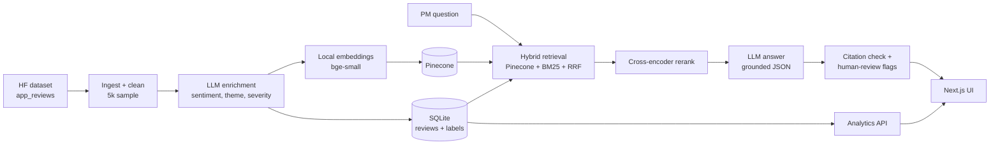

# InsightAI: RAG-Powered Product Feedback Intelligence

InsightAI turns unstructured customer feedback into **evidence-backed product insights**. Product managers ask
questions in plain English ("Why are users uninstalling?") and get a structured answer where **every claim is
cited back to real reviews**, plus dashboards that rank product opportunities by business impact.

> InsightAI does not replace product managers. It flags low-evidence, conflicting, or high-impact answers for human review.

## Features

- **Ask questions over feedback (RAG):** hybrid retrieval (vector + BM25), cross-encoder reranking, and grounded JSON answers with citations
- **Citation verification:** any evidence id the LLM cites that was not actually retrieved is dropped
- **Human-review triggers:** insufficient evidence, conflicting sentiment, low confidence, weak citations, high-ARR recommendations
- **LLM enrichment pipeline:** each review is labelled with sentiment, theme, severity, type, churn risk, and a summary (batched, resumable)
- **Dashboard:** KPIs, top problem themes by ARR impact, volume and sentiment trends
- **Ranked opportunities + decision matrix:** impact score from evidence volume, ARR at risk, severity, and year-over-year trend
- **Customer segments:** sentiment, churn risk, and top problems per segment
- **Feedback + evidence libraries:** search and filter all 5,000 reviews, with citable high-severity quotes
- **Retrieval evaluation:** Hit@k, Precision@k, and MRR for dense vs hybrid vs hybrid + rerank
- **Works offline:** falls back to rule-based labels, a local vector index, and extractive answers if the LLM or Pinecone is unavailable

## Architecture



## Tech Stack

| Layer | Tech |
|---|---|
| Frontend | Next.js 15 (React 19, TypeScript), Tailwind CSS 4, Recharts, lucide-react |
| Backend | Python 3.12, FastAPI, pandas, SQLite |
| LLM | Any OpenAI-compatible API: [FreeLLMAPI](https://github.com/tashfeenahmed/freellmapi) (default), Groq, or Gemini |
| Embeddings | `BAAI/bge-small-en-v1.5` via fastembed (ONNX, CPU, free) |
| Reranker | `ms-marco-MiniLM-L-6-v2` cross-encoder via fastembed |
| Vector DB | Pinecone serverless (free Starter plan), with a local numpy fallback |
| Keyword search | BM25 (`rank-bm25`), fused with Reciprocal Rank Fusion |
| Testing | pytest, plus a retrieval evaluation script |

## Data

[`sealuzh/app_reviews`](https://huggingface.co/datasets/sealuzh/app_reviews): 288k real user reviews of open-source
Android apps (F-Droid). After cleaning (length 20 to 1,500 characters, de-duplicated), a fixed-seed sample of **5,000 reviews**
from 301 apps (2014 to 2017) is used.

The dataset has no customer or revenue fields, so each review is assigned to one of 600 **synthetic customer accounts**
(segment + ARR) with a fixed seed, so the business-impact features can be demonstrated. The review text, ratings, and dates are real.

## Retrieval Evaluation

`python -m eval.eval_retrieval` runs 20 labelled questions (k=8). A result counts as relevant when its theme label matches the expected theme.

| Mode | Hit@8 | Precision@8 | MRR | Avg latency |
|---|---|---|---|---|
| Dense only (vectors) | 1.00 | 0.669 | 0.892 | 20 ms |
| Hybrid (vectors + BM25, RRF) | 1.00 | 0.669 | 0.877 | 27 ms |
| Hybrid + cross-encoder rerank | 0.95 | **0.694** | **0.900** | 461 ms |

Reranking gives the best precision and MRR at the cost of latency. These numbers were measured with rule-based labels
(offline mode). Re-run the script after LLM enrichment for final figures (`eval/results.json`).

## Run Locally

**Requirements:** Python 3.12, Node 20+

```bash
# 1. Backend
cd backend
python -m venv .venv
.venv\Scripts\activate            # macOS/Linux: source .venv/bin/activate
pip install -r requirements.txt
cp .env.example .env              # add your FreeLLMAPI / Pinecone keys (optional)
python -m pipeline.run            # download, label, and index 5k reviews
uvicorn app.main:app --port 8000

# 2. Frontend (new terminal)
cd frontend
npm install
npm run dev                       # http://localhost:3000
```

### Using FreeLLMAPI for the LLM

1. Install and run [FreeLLMAPI](https://github.com/tashfeenahmed/freellmapi) (Docker or the desktop app). It serves `http://localhost:3001/v1`.
2. Add free provider keys (e.g. Google AI Studio, Groq) in its dashboard.
3. Put its unified key in `backend/.env` as `LLM_API_KEY`.
4. Re-label with the LLM: `python -m pipeline.enrich --mode llm --redo-heuristic`, then `python -m pipeline.index`.

### Using Pinecone

Create a free key at [pinecone.io](https://www.pinecone.io), set `PINECONE_API_KEY` in `backend/.env`, and run
`python -m pipeline.index`. The index (384 dimensions, cosine) is created automatically, and cached embeddings are reused.

## API

| Method | Path | Description |
|---|---|---|
| POST | `/api/query` | `{question, filters?}` → grounded answer, evidence, review flags, latency |
| GET | `/api/overview` | KPIs, themes by impact, monthly volume and sentiment |
| GET | `/api/opportunities` | Ranked opportunities with score, priority, confidence, evidence |
| GET | `/api/segments` | Per-segment sentiment, churn risk, top problems |
| GET | `/api/feedback` | Search and filter reviews (`q`, `sentiment`, `severity`, `theme`, `segment`, `page`) |
| GET | `/api/health` | Pipeline, vector store, and LLM status |

Interactive docs: `http://localhost:8000/docs`

## Tests

```bash
cd backend
python -m pytest -q
```

## Project Structure

```
backend/
  app/          FastAPI app, retrieval, RAG, analytics, LLM + vector store clients
  pipeline/     ingest -> enrich -> index
  eval/         retrieval evaluation set + script
  tests/        pytest suite
frontend/
  src/app/      7 screens: chat, dashboard, feedback, opportunities, prioritization, evidence, segments
  src/components, src/lib
```
