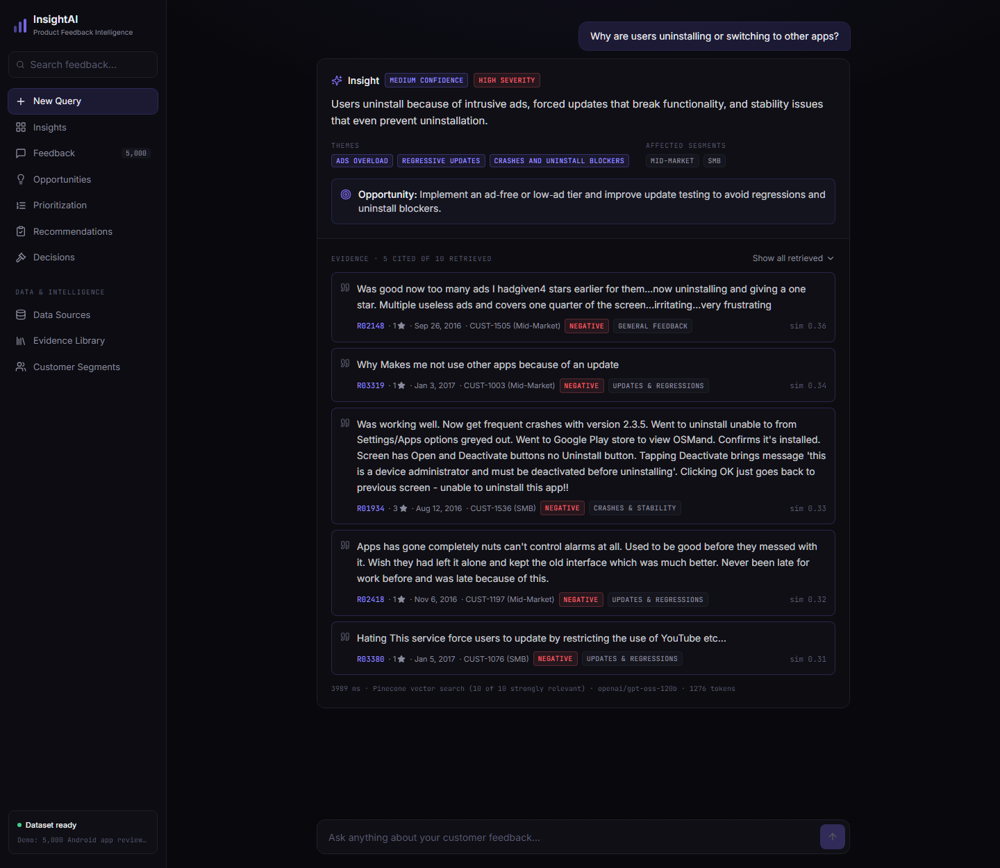
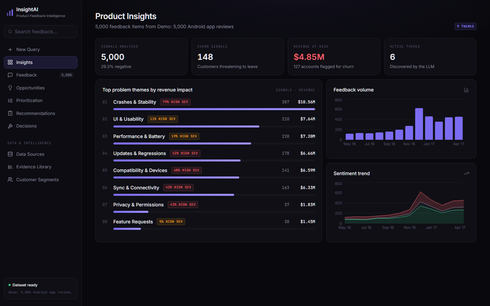
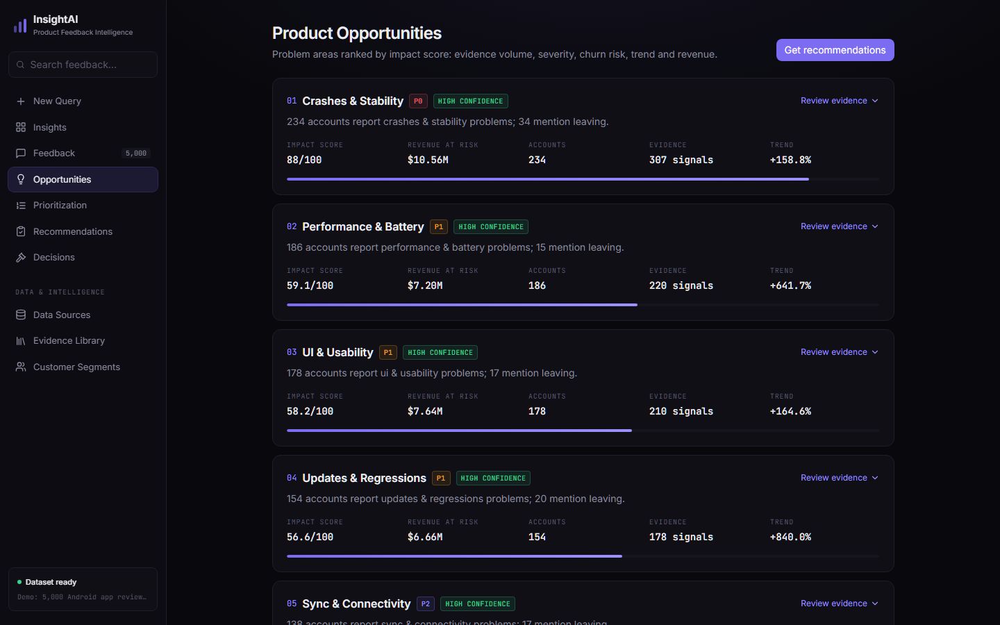
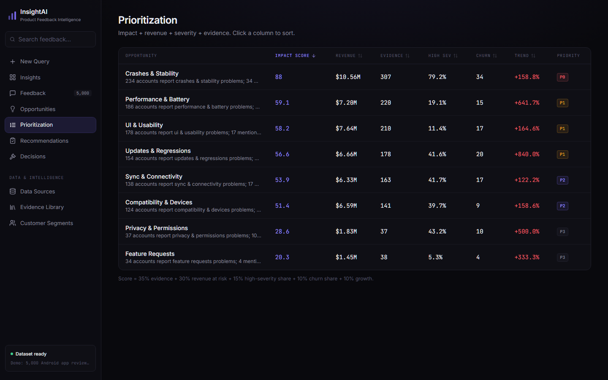
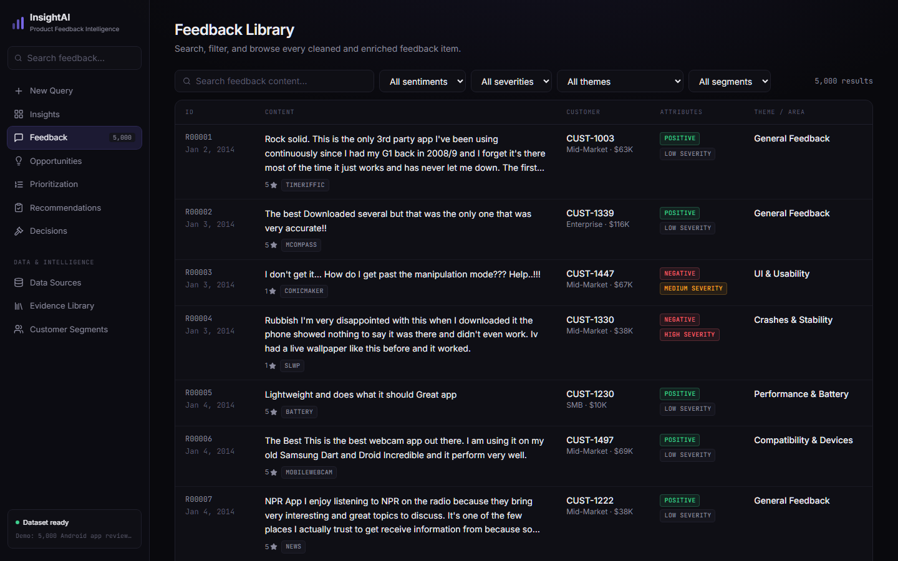
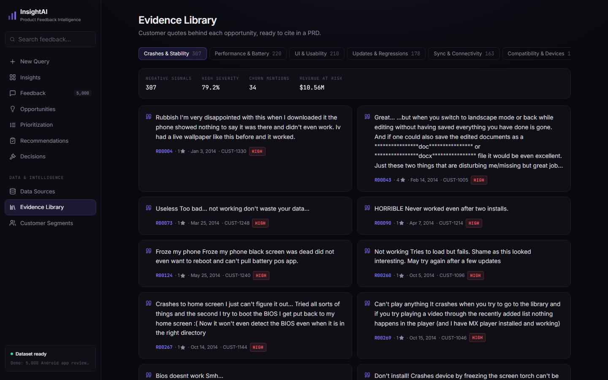
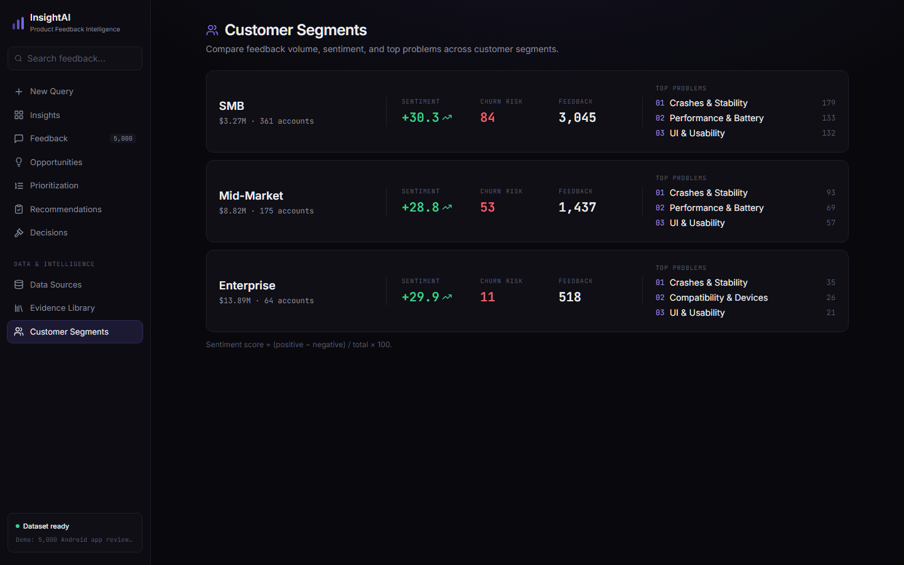
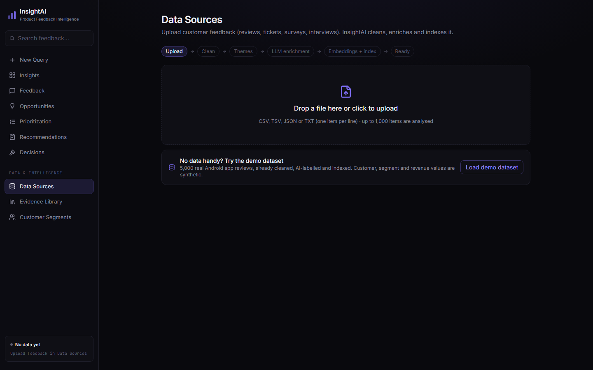
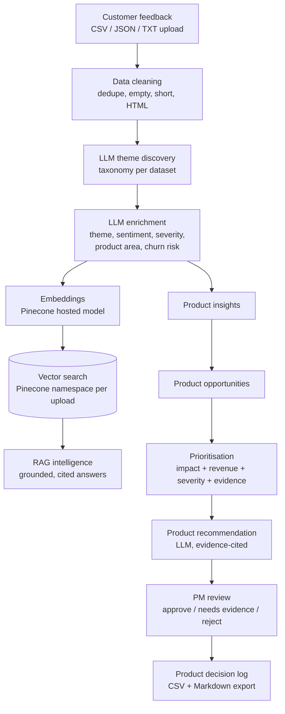

# InsightAI: RAG-Powered Product Feedback Intelligence


Upload customer feedback (reviews, support tickets, surveys, interview notes) and InsightAI turns it into
**evidence-backed product insights, prioritised opportunities and recommendations**, with a PM review step and a
decision log. Every AI answer is **cited back to the customer's own words**.

> InsightAI does not replace product managers. It flags low-evidence, conflicting, or high-impact answers for human review,
> and every recommendation needs a PM decision.

**Live demo:** [insightai-silk.vercel.app](https://insightai-silk.vercel.app/?demo=1) (opens with a 5,000-review demo dataset loaded)



## Screenshots

| Product insights | Product opportunities |
|---|---|
|  |  |
| **Prioritization** | **Feedback library** |
|  |  |
| **Evidence library** | **Customer segments** |
|  |  |
| **Data sources (upload)** | |
|  | |

## Workflow



## Features

- **Upload any feedback file:** CSV, TSV, JSON or TXT, with automatic column detection (text, date, rating, customer, segment, revenue, source)
- **One-click demo dataset:** 5,000 real app reviews, pre-labelled and pre-indexed, so trying the app costs no AI quota
- **Shareable links:** `?demo=1` on any page loads the demo; `/?demo=1&q=...` asks a question on open
- **Data cleaning report:** empty rows, too-short items, duplicates and HTML entities handled; up to 1,000 items per upload
- **Dynamic themes:** the LLM proposes a theme taxonomy for each dataset, then labels every item against it
- **LLM enrichment:** sentiment, theme, severity, product area, feedback type, churn risk and a summary, in resumable batches
- **Vector search:** Pinecone hosted embeddings (`llama-text-embed-v2`) with a private namespace per upload, auto-deleted after 24 hours
- **RAG answers:** structured JSON answers; citations that were not actually retrieved are dropped
- **Human-review triggers:** insufficient evidence, conflicting sentiment, low confidence, weak citations, high-revenue impact
- **Prioritisation:** impact score from evidence volume, revenue at risk, severity, churn share and trend (re-weighted when a column is missing)
- **Recommendations + PM review + decisions:** evidence-cited recommendations, approve / reject / needs-evidence with notes, exportable decision log
- **Multi-provider LLM failover:** rotates across free Groq models and falls back to Gemini when Groq hits its limits
- **No API key for visitors:** keys live in server-side functions; per-visitor daily limits protect the free quotas

## Tech Stack

| Layer | Technology | Used for |
|---|---|---|
| **Frontend** | Next.js 16 (App Router), React 19, TypeScript | 10 pages: chat, upload, insights, opportunities, prioritisation, recommendations, decisions, and more |
| **Styling + charts** | Tailwind CSS 4, Recharts, lucide-react | Dark dashboard UI, volume and sentiment charts |
| **Backend (serverless)** | Next.js route handlers on Vercel | `/api/themes`, `/api/enrich`, `/api/index`, `/api/ask`, `/api/recommend`; API keys stay server-side |
| **LLM** | Groq (`gpt-oss-120b`, `gpt-oss-20b`) | Theme discovery, enrichment, RAG answers, recommendations |
| **Backup LLM** | Google Gemini (`gemini-3.5-flash-lite`) | Automatic failover when Groq hits rate limits |
| **Embeddings** | Pinecone Inference (`llama-text-embed-v2`, 1024 dims) | Hosted embeddings for feedback and questions |
| **Vector database** | Pinecone serverless | Semantic search, one namespace per upload (auto-deleted after 24h) |
| **Data handling** | PapaParse, browser localStorage | CSV/JSON/TXT parsing, cleaning, dataset + PM decisions storage |
| **Hosting** | Vercel (free Hobby plan) | Deploys on every push to `main` |
| **Research pipeline** | Python 3.12, FastAPI, pandas, SQLite | Offline pipeline used to design and test the approach |
| **Retrieval research** | fastembed (`bge-small-en-v1.5`), BM25 (`rank-bm25`), cross-encoder rerank | Hybrid search experiments and evaluation |
| **Testing + eval** | pytest, custom retrieval eval (Hit@k, Precision@k, MRR) | 8 unit/API tests, 20-question retrieval benchmark |
| **Test data** | Hugging Face `sealuzh/app_reviews` | 5,000 real Android app reviews (demo dataset) |

## Run Locally

```bash
cd frontend
npm install
cp .env.example .env.local    # add GROQ_API_KEY, GEMINI_API_KEY, PINECONE_API_KEY
npm run dev                   # http://localhost:3000, then upload a file in Data Sources
```

All three keys are free: [Groq](https://console.groq.com/keys), [Gemini](https://aistudio.google.com/apikey),
[Pinecone](https://app.pinecone.io). The Pinecone index is created automatically on the first upload.

## Deploy to Vercel (free)

1. Import this repository at [vercel.com/new](https://vercel.com/new) and set **Root Directory** to `frontend`.
2. Add the environment variables from `frontend/.env.example`.
3. Deploy. Every push to `main` redeploys.

## Research Pipeline and Evaluation (`backend/`)

The Python pipeline was used to design and evaluate the retrieval approach on a test set of 5,000 real Android app
reviews ([`sealuzh/app_reviews`](https://huggingface.co/datasets/sealuzh/app_reviews), with synthetic account data).
All 5,000 were labelled by an LLM, then `python -m eval.eval_retrieval` scored 20 labelled questions (k=8):

| Mode | Hit@8 | Precision@8 | MRR |
|---|---|---|---|
| Dense only (Pinecone) | 1.00 | **0.875** | 0.975 |
| Hybrid (Pinecone + BM25, RRF) | 1.00 | 0.856 | 0.975 |
| Hybrid + cross-encoder rerank | 1.00 | 0.838 | **1.000** |

```bash
cd backend
python -m venv .venv && .venv\Scripts\activate
pip install -r requirements.txt
cp .env.example .env          # LLM_API_KEY (Groq), GEMINI_API_KEY, PINECONE_API_KEY
python -m pipeline.run        # ingest -> enrich -> index the test set
python -m eval.eval_retrieval # retrieval metrics
python -m pytest -q
python -m pipeline.export_demo  # publish the test set as the web app's demo (JSON + Pinecone namespace)
```

## Project Structure

```
frontend/
  src/app/            pages: chat, upload, insights, feedback, opportunities, prioritization,
                      recommendations, decisions, evidence, segments
  src/app/api/        serverless routes: themes, enrich, index, ask, recommend
  src/lib/            cleaning, pipeline, analytics, store, server clients (LLM, Pinecone)
backend/
  app/ pipeline/ eval/ tests/    Python research pipeline and evaluation
```
